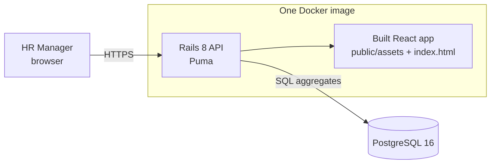
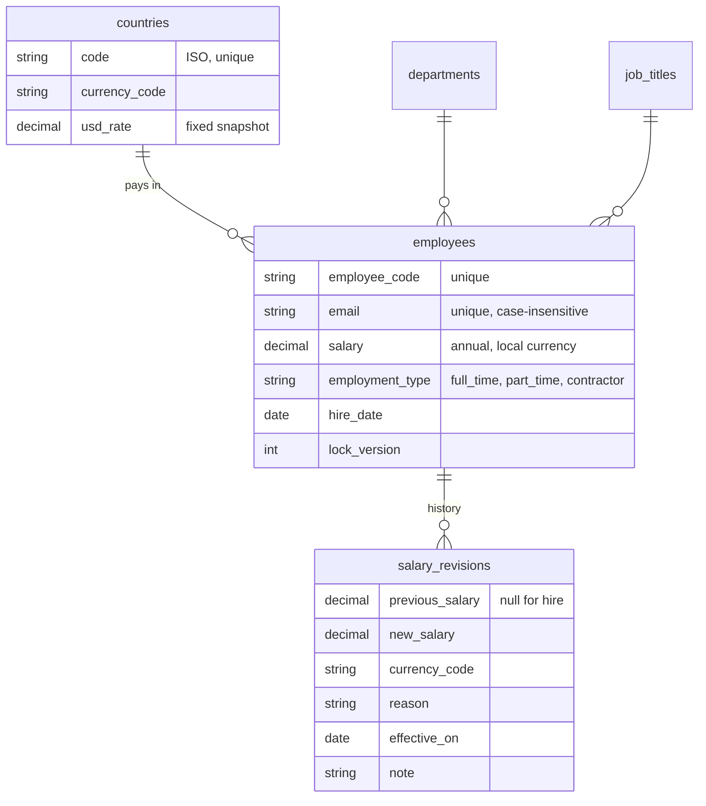

# Architecture and trade-offs

## Overview

- **Backend:** Rails 8 in API mode, PostgreSQL 16, RSpec and FactoryBot.
- **Frontend:** React 19, TypeScript, Vite, Mantine 8, TanStack Query, React Router; tests with Vitest and
  Testing Library.
- **Deployment:** one Docker image. In production Rails serves the built React app as well as the API, so
  there is one service, one URL and no CORS. In development Vite proxies `/api` to Rails.

### Backend layout

| Layer | Files | Responsibility |
|-------|-------|----------------|
| Models | `app/models` | Data rules: validations, `Employee#revise_salary!`, read-only salary revisions |
| Query objects | `app/queries` | `EmployeeSearch` (filters, search, sort), `Pagination`, `PayInsights` (all statistics) |
| Serializers | `app/serializers` | The JSON shape the UI reads; money is sent as a decimal string |
| Controllers | `app/controllers/api` | Thin: read params, call a query or model, render |
| Seeding | `lib/seeding` | Reference data and a deterministic 10,000-employee generator |

Controllers stay thin and the logic sits in plain Ruby objects, so most behaviour is tested without HTTP.

### Frontend layout

| Folder | Responsibility |
|--------|----------------|
| `src/api` | Typed `request()` wrapper, API types, one TanStack Query hook per endpoint |
| `src/lib` | Pure logic: URL filter state, formatting, mapping server errors onto form fields |
| `src/components` | Table, filters, forms, salary history |
| `src/pages` | One page per route: Employees, Employee, Pay insights, Pay outliers |

## Data model

Rules the database enforces as well as the models: positive salaries, valid employment types and reasons,
unique codes and emails, foreign keys. A bug or a bulk script can then never write a row the app would
reject.

## Key decisions

**Salary is stored in local currency; USD is computed.** People are paid in local currency, so that is the
real figure. Each country has one currency and one fixed `usd_rate`. Cross-country views multiply in SQL
(`salary * usd_rate`). Per-country views stay in local currency, so exchange rates cannot distort them.
*Trade-off:* the rates are a snapshot that HR updates on purpose. Live rates would make reports change on
their own from day to day.

**Every salary change has a reason.** The `salary` column can only change through
`Employee#revise_salary!`. That method locks the row, writes a `SalaryRevision` (old value, new value,
currency, reason, effective date, note) and updates the salary in one transaction. A normal edit that
tries to change salary fails validation, and the update endpoint does not accept `salary` at all.
Revisions are read-only once saved; a mistake is fixed with a new `correction` revision. *Trade-off:*
there is one extra step compared with a spreadsheet cell. The answer to "why did this change?" is worth
it.

**Country cannot change after hiring.** A change of country is a relocation: the currency changes, and
usually the pay. Allowing a plain edit would silently turn ₹2,000,000 into €2,000,000. A relocation flow is
listed as future work.

**Lost updates are blocked.** `employees.lock_version` turns on Rails optimistic locking. If two people
edit the same employee, the second save gets a 409 and a message to reload, instead of overwriting.

**Pay statistics count full-time staff by default.** Part-time and contractor pay is not comparable and
would pull medians down. Headcount and payroll still count everyone, because that is the real spend. The
UI has a "Full-time only / Everyone" switch.

**The median is shown alongside the average.** A few high earners skew the average. PostgreSQL's
`percentile_cont(0.5)` computes the median in the database.

**Outliers compare like with like.** Peers are people with the same job title in the same country.
Groups with fewer than 5 people are skipped, because a median of two people means little. The threshold
(±15%, ±25% or ±40%) is chosen in the UI.

**Directory filters live in the URL.** A filtered, sorted page can be bookmarked or shared, and it survives
a reload. The parser ignores values it does not recognise, so a hand-edited URL never breaks the page.

**Sorting by salary uses USD.** Sorting by the raw number would put ¥9,000,000 above $150,000.

## Performance

The target was under 300 ms per request with 10,000 employees. Measured locally, in development mode,
median of 3 runs:

| Request | Time |
|---------|------|
| Directory page (default sort) | 12 ms |
| Directory: name search + sort by USD salary | 28 ms |
| Directory: 3 countries + department, page 10 | 9 ms |
| Insights: summary / countries / job titles / departments | 12 / 28 / 15 / 26 ms |
| Outliers (peer medians for every group) | 53 ms |
| CSV export of all 10,000 rows (streamed) | 1.1 s |
| Seeding 10,000 employees + 35,588 revisions | about 4 s |

How:

- **No statistics in Ruby.** Every count, sum, average and median is one SQL aggregate.
- **Indexes match the queries.** `(country_id, job_title_id, salary)` serves the per-country, per-title
  statistics and outliers. There are also indexes on `salary`, `hire_date` and `(last_name, first_name)`.
  A trigram GIN index on `first_name || ' ' || last_name` serves `ILIKE '%term%'` search (0.9 ms in
  `EXPLAIN ANALYZE`).
- **Paging is done by the server** (25 rows per page, maximum 100), with `id` as a tie-breaker so page
  boundaries are stable.
- **The CSV export streams** in pages of 1,000 rows in the user's sort order, so memory stays flat.
- **Seeding uses `insert_all`** in batches of 1,000 instead of 10,000 separate saves.
- **The UI keeps the previous page on screen** while the next one loads (`keepPreviousData`), and debounces
  search by 300 ms, so typing sends one request.

Next steps if the data grew 100 times: keyset (cursor) paging instead of `OFFSET`; a materialised view
for the insights, refreshed on write; a background job for exports.

## Testing

| Suite | Count | Covers |
|-------|-------|--------|
| RSpec models | 17 | Validations, hire revision, `revise_salary!` (including rollback), read-only history, code assignment |
| RSpec queries | 11 | `PayInsights`, with numbers worked out by hand (medians, USD conversion, full-time scope, outliers) |
| RSpec seeding | 3 | Same seed gives the same data; every history starts at hire and ends at the current salary |
| RSpec requests | 27 | Every endpoint: filters, sort safety, CSV, validation errors, 404/409, client-side routes |
| Vitest | 31 | API client errors, URL filter state (including rapid changes), formatting, the directory page, the salary change form |

All tests are deterministic: fixed factories, a fixed seed, no network (`fetch` is mocked in the UI).
The backend suite runs in about 2 seconds and the frontend suite in about 7 seconds. CI runs both, plus
RuboCop, oxlint and the production build, on every push.

The full workflow (add, change salary, edit, remove, duplicate-email error) was also run in a real
browser against the seeded database. That run found one bug, which is fixed and covered in the commit
history: after a delete, the app re-requested the deleted employee.

## Security notes

- Strong parameters, with an explicit list of fields per action. Salary and country cannot be mass-assigned
  on update.
- Search input is length-capped and its `%`/`_` characters are escaped. Sort keys come from an allow-list,
  so no user input reaches `ORDER BY`.
- HTTPS is forced in production, except for the `/up` health check.
- **Not done (see requirements):** authentication. In real use this would be the first addition, behind
  the company's single sign-on.

## Future work

1. Single sign-on and an audit field for who made each change.
2. A relocation flow (change of country, currency and salary together).
3. Pay bands per job title and level, with each person's position in their band.
4. CSV/Excel import with a preview and validation step, for the move away from spreadsheets.
5. Pay-gap reporting, once there is a policy on handling the sensitive data it needs.
